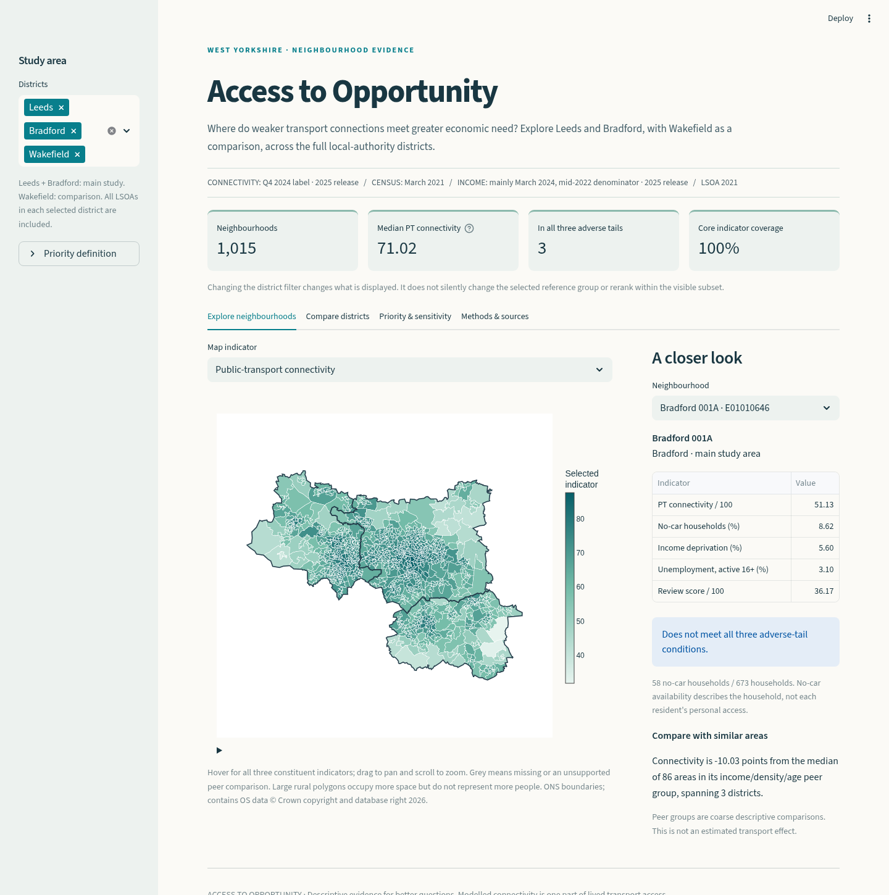

# Access to Opportunity

### Neighbourhood Transport Accessibility in Leeds, Bradford and Wakefield

**Which neighbourhoods combine weak transport connectivity, many households without a car and high income deprivation?** This reproducible, descriptive study covers the full Leeds and Bradford districts, with Wakefield as a comparison. It includes all **1,015 LSOA 2021 neighbourhoods**, not a selection of city-centre examples.

Built with Python, pandas, GeoPandas, DuckDB, Plotly and Streamlit. No machine learning is needed to answer the research question.



## What the official data shows

| District | LSOAs | Median public-transport connectivity | Households without a car |
|---|---:|---:|---:|
| Leeds | 488 | 73.59 | 28.72% |
| Bradford | 312 | 71.60 | 27.59% |
| Wakefield | 215 | 64.18 | 22.82% |

Connectivity is DfT's **Overall (public transport)** score, covering several destination purposes. It is not employment-only access, minutes, a percentile, or a count of reachable jobs. Medians treat each neighbourhood equally; car percentages use summed household counts.

Under the predefined pooled-quartile rule, three areas meet all three adverse conditions: **Bradford 012C, Wakefield 039D and Wakefield 011E**. Across reasonable threshold and comparison choices, the count ranges from **1 to 24**. These are places for further investigation, not a validated funding allocation. A zero baseline count for Leeds does not mean Leeds has no transport disadvantage.

An instructive result: better connectivity is positively associated with no-car household share, both across the study and within each district. Poor connectivity and high need do not automatically coincide. This helps explain why the three-way overlap is small; it does not establish why households lack cars.

Read the [findings and supporting tables](reports/findings.md), [feasibility assessment](reports/feasibility.md) and [data-quality report](reports/data_quality.md). Numbers above describe this pinned release, not current transport conditions in 2026.

## Run the project

Use **Python 3.12**. The tested environment is Linux; GeoPandas and PyArrow are installed from wheels. Allow several minutes for the first download and streaming workbook extraction. The 68 MB DfT workbook contains roughly 1.1 GB of XML, which the pipeline reads incrementally. Subsequent builds reuse a checksum-verified extraction.

```bash
git clone https://github.com/shayan2578-S/Project-1.git
cd Project-1
python3.12 -m venv .venv
source .venv/bin/activate
python -m pip install -r requirements-lock.txt
python -m opportunity acquire --locked
python -m opportunity build
python scripts/write_dictionary.py
python -m pytest -q
python -m streamlit run app.py
```

On Windows, activate with `.venv\Scripts\Activate.ps1`; adapt the notebook runner's `.venv/bin` paths if needed. Linux is the verified platform. No API keys are required. The map uses downloaded ONS polygons without external basemap tiles. It requires a browser with WebGL support.

On Linux/macOS, the equivalent convenience targets are `make setup`, `make data`, `make build`, `make test`, and `make dashboard`. `make setup` expects `python3` to be version 3.12.

**Acquisition is explicit.** The dashboard does not download data or substitute sample records. It stops with instructions if the build is absent or the study configuration has changed. Raw downloads, processed tables, virtual environments and runtime artifacts are ignored by Git. Source registers, reviewed mappings, reports, code and the executed notebook belong in the repository.

### Explore the notebook

```bash
make notebook
```

This registers a kernel inside `.venv`, executes every code cell and saves the outputs in [01_access_to_opportunity.ipynb](notebooks/01_access_to_opportunity.ipynb). The notebook follows the research questions from source inspection to weighting, sensitivity and descriptive peer comparisons. For interactive editing, open it in VS Code/Jupyter and select the project interpreter; a separate Jupyter user interface is optional.

### Tests and verification

`python -m pytest -q` checks household and economic-activity denominators, missingness, tie handling, score direction, invalid weights, geographic join cardinality, real source/output checksums, SQL summaries and dashboard controls. Integration and dashboard checks explicitly skip when official data has not been built; skipped checks are not evidence that the dashboard works.

An optional browser smoke check exercises rendered maps, district filtering and tabs. Install `requirements-browser.txt`, run `python -m playwright install chromium`, start Streamlit, then run `python scripts/browser_smoke.py`. See [verification evidence](reports/verification.md) for the actual completed checks and platform. CI runs the offline calculation checks; full official-data/browser verification is a separate workflow.

## Data and analytical decisions

| Source | Used for | Dates and geography |
|---|---|---|
| [DfT Transport Connectivity Metrics](https://www.gov.uk/government/publications/transport-connectivity-metric) | Overall PT score; separate walking, cycling, driving and sustainable-mode context | 2025 release, labelled Q4 2024, mixed input dates; LSOA 2021 |
| [ONS Census via Nomis](https://www.nomisweb.co.uk/census/2021/bulk) | TS045 car availability; TS066 activity; TS067 qualifications; TS001 population; TS006 density; TS007a ages | 21 March 2021, pandemic-era; LSOA 2021 |
| [English Indices of Deprivation 2025](https://www.gov.uk/government/statistics/english-indices-of-deprivation-2025) | Income deprivation from corrected File 7, not overall IMD | Mainly March 2024 numerator / mid-2022 denominator; LSOA 2021 |
| [ONS Open Geography](https://geoportal.statistics.gov.uk/) | Official district lookup and BGC V5 polygons | LSOA 2021 to LAD May 2024; 20 m generalised boundaries |

The [source register](metadata/source_register.csv) records publisher, landing page, actual download URL, reference period, geography, licence, retrieval time and SHA-256. [source_lock.json](metadata/source_lock.json) pins the 31 original files consumed by the build. [Reviewed mappings](config/verified_inputs.yml) preserve exact observed column labels. Original downloads are retained under their checksums in `data/raw/`; intermediate extraction and processed results are separate.

The main decisions are documented in [methodology](docs/methodology.md):

- Car non-availability uses **households**, not residents. Unemployment divides unemployed residents by the **economically active population aged 16+**, including active full-time students.
- Income deprivation represents economic need. Overall IMD and geographical barriers are excluded to avoid incorporating accessibility into both sides of the comparison.
- An all-three-tail flag and a weighted percentile review score are different outputs. Every constituent remains visible. The baseline is pooled quartiles with equal weights; 27 scenarios test thresholds, weights and reference groups.
- Full-district ONS lookup membership defines the study before data joins. One-to-one left joins retain all eligible areas; incompatible geography, duplicates, invalid polygons and changed checksums fail explicitly.
- Peer comparisons use coarse income/density/age groups with at least five neighbourhoods across two districts. They describe differences and do not estimate transport effects.

For all fields, units, formulas, source columns and missing-value rules, see the [data dictionary](docs/data_dictionary.md) and its [machine-readable version](metadata/data_dictionary.csv).

## Repository guide

```text
app.py                      Streamlit dashboard
config/                     Study scope, discovery rules, reviewed mappings
opportunity/                Acquisition, geography, preparation, analysis, charts
sql/district_summary.sql    Actual DuckDB aggregation used in the build
notebooks/                  Executed exploratory analysis
metadata/                   Source register, checksums and inspected metadata
reports/                    Feasibility, findings, data quality, verification
docs/                       Methodology, dictionary, acquisition and interview guide
scripts/                    Notebook, dictionary and browser helpers
tests/                      Calculations, joins, real-data and dashboard checks
data/raw/                   Unmodified downloads (ignored)
data/interim/               Checked workbook extraction (ignored)
data/processed/             Tables, maps, DuckDB database, build manifest (ignored)
```

## Update releases or extend the area

Reproduction uses `acquire --locked`. To **discover** newer releases, use `python -m opportunity acquire --refresh`, inspect the returned files and definitions, and review `config/verified_inputs.yml` before changing any checksum. Discovery never silently changes the analysis input. Dynamic publication pages remain in the source register but are not checksum prerequisites for rebuilding unchanged data.

To add another West Yorkshire district, add its official code, name and main/comparison role to `config/study.yml`; run `python -m opportunity geography --update-mappings`, then rebuild, regenerate the dictionary/notebook and rerun tests. The geography step checks names against ONS and retrieves complete polygons. National tables already cover England. Adding areas changes pooled percentiles, peers and interpretation: revise the written study scope and dashboard wording accordingly. Detailed steps and any acquisition troubleshooting are in [data access](docs/data_access.md).

## Limitations, attribution and licence

This is observational, neighbourhood-level evidence with different source years. It cannot describe every resident, prove transport causes unemployment, measure timetable reliability, infer vacancies from existing jobs, or estimate new 30/45/60-minute reachable-job counts. Car availability does not establish personal access to a car. Census disclosure control, model assumptions, incomplete transport dimensions and threshold sensitivity matter. Neither peer comparisons nor scenario frequencies are causal estimates or confidence probabilities.

DfT's workbook labels the PT-purpose column `Business (public transport)` while other modes use `Employment`; it is preserved as unresolved and excluded from employment interpretation. Published `Employment (overall)` is available separately. The workbook's licence cell says **TBA**, despite OGL terms on the GOV.UK guidance: this discrepancy remains explicit and original files are not bundled in Git.

Contains public sector information licensed under the [Open Government Licence v3.0](https://www.nationalarchives.gov.uk/doc/open-government-licence/version/3/), where stated by the relevant publisher. Census: Office for National Statistics via Nomis. Connectivity: Department for Transport. Deprivation: Ministry of Housing, Communities and Local Government. **Source: Office for National Statistics licensed under OGL v3.0. Contains OS data © Crown copyright and database right 2026.** See the register for source-specific terms. The repository's existing [Unlicense](LICENSE) applies to project code, not third-party data rights.

For interview preparation, start with the [90-second explanation, decisions and questions](docs/interview.md). Optional BRES, bus timetable/routing and historical JTS extensions remain outside the verified core.
